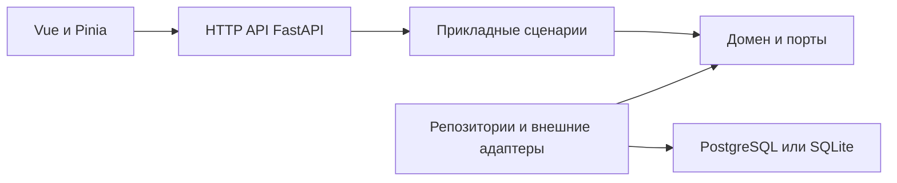

# Архитектура Menutor

Menutor — веб-приложение с отдельным браузерным интерфейсом и HTTP API. Vue отвечает за экраны и взаимодействие, FastAPI — за обработку запросов и доступ к операциям, SQLAlchemy — за хранение данных. Контракт HTTP доступен через Swagger UI по `/docs` на backend и через `/openapi.json`.

## Ответственность слоёв

- **Интерфейс** отображает каталоги, сетку меню, сводку и списки покупок. Pinia хранит состояние экранов, а общий HTTP-клиент отправляет запросы и обрабатывает обновление токенов.
- **HTTP API** проверяет входные данные, определяет пользователя и переводит результаты прикладных операций в ответы.
- **Прикладной слой** координирует операции пользователя, загрузку данных и вызовы доменных правил. Домен определяет расчёт порций, масштабирование и развёртывание рецептов, агрегацию покупок, стоимость и проверку предпочтений.
- **Инфраструктура** реализует репозитории, миграции, хеширование паролей, токены, преобразование файлов и генерацию PDF. Компоненты связываются в точке сборки приложения.

## Жизненный цикл сессии БД

При запуске HTTP-приложение создаёт engine и фабрику сессий SQLAlchemy, применяет миграции и заполняет справочник единиц измерения. При остановке приложение освобождает пул соединений.

Для каждого HTTP-запроса, использующего прикладные сценарии, FastAPI создаёт отдельную сессию и связывает с ней репозитории и сценарии. Аутентификация и обработчик запроса получают один и тот же контейнер. При завершении запроса сессия закрывается, а незавершённая транзакция откатывается независимо от результата запроса.

## Поток данных

Меню ссылается на блюда и отдельные продукты. Сводка объединяет повторяющиеся позиции и масштабирует их по выбранным приёмам пищи. При формировании списка покупок система разворачивает вложенные рецепты, складывает количества по продуктам и пересчитывает их в закупочные единицы. Сохранённый список можно редактировать отдельно от меню.

Основные рабочие записи привязаны к аккаунту. Категории продуктов и рецептов принадлежат аккаунту. Справочник единиц измерения общий. Семья, пользовательские типы приёмов пищи и пищевые предпочтения задают контекст планирования.

Команды запуска, настройки БД и миграций вынесены в [руководство разработчика](CONTRIBUTIND.md).
